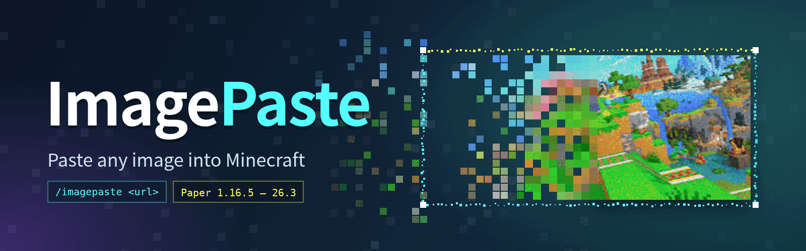
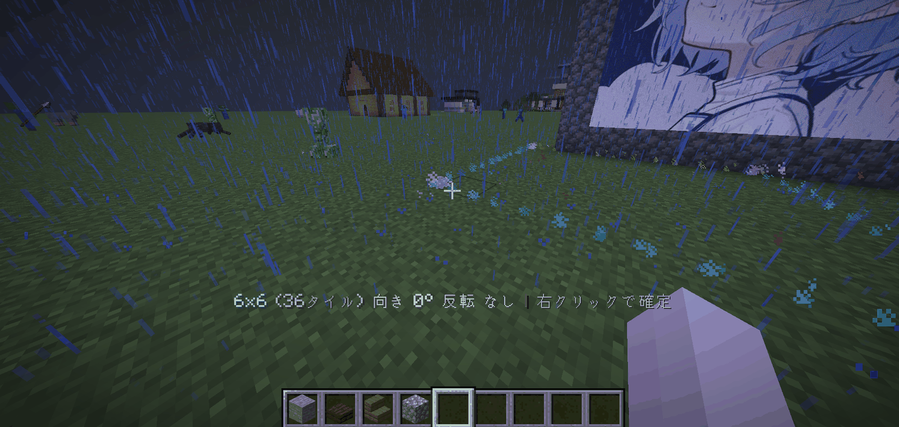
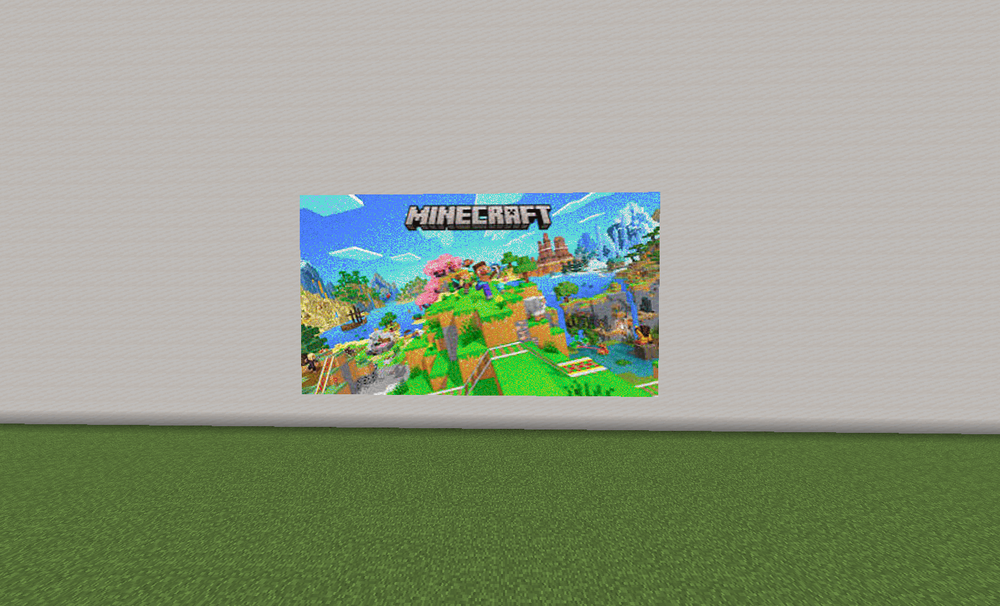

<div align="center">

<p align="center"></p>

<p align="center"><a href="README.md">English</a> | <b>日本語</b></p>

<h1 align="center">ImagePaste</h1>

<h3 align="center">URL の画像を、地図タイルとして壁・床・天井に貼る。</h3>

<p align="center">Minecraft の Paper プラグインです。貼る前にパーティクルの枠でプレビューでき、大きさ・向き・反転をその場で調整できます。</p>

<p align="center">
  <a href="https://github.com/Lapius7/imagepaste-plugin/releases/latest"></a>
  
  
  
  <a href="https://github.com/Lapius7/imagepaste-plugin/stargazers"></a>
  <a href="https://github.com/Lapius7/imagepaste-plugin/commits/main"></a>
</p>

<p align="center">
  <a href="#クイックスタート">クイックスタート</a> ·
  <a href="#コマンド">コマンド</a> ·
  <a href="#設定">設定</a> ·
  <a href="#安全のために">安全のために</a> ·
  <a href="#対応バージョン">対応バージョン</a>
</p>

</div>

---

`/imagepaste <URL>` を実行して貼りたい面を見て、右クリックするだけです。画像は地図の色に減色され、地図を入れた不可視の額縁として並びます。

<table>
  <tr>
    <td width="50%" align="center"><br><b>プレビュー</b><br>パーティクルの枠が出て、操作はボスバーとチャットに表示されます。水色が外周、白が四隅、黄色が画像の<b>上辺</b>です。置けない枠が1つでもあると、全体が赤になります。</td>
    <td width="50%" align="center"><br><b>貼り付け結果</b><br>右クリックで確定すると、画像が地図タイルとして壁に並びます。</td>
  </tr>
</table>

## 特長

- **貼る前にプレビュー**: 見ている面に枠が出ます。届く距離は `preview.max-distance`(既定 64 ブロック)です。
- **その場で調整**: Shift+スクロールで拡縮、`F` で回転、`Q` で反転。右クリックで確定、左クリックで中止します。
- **どの面にも**: 壁・床・天井に貼れます。
- **大きな画像**: 複数 tick に分けて置き、進捗をボスバーに出します。`/imagepaste cancel` で中止して片付けられます。
- **管理**: `list` / `undo` / `remove` / `tp`。記録は再起動後も残ります。
- **保護**: 貼った額縁は、破壊・回転・地図の取り出しを拒否します。
- **取得先の制限**: 内部アドレスを拒否し、サイズ・時間・ポートに上限があります。ホストの許可リストも使えます。
- **文言**は `lang.yml`(MiniMessage)で変えられます。

## クイックスタート

Paper サーバー(1.16.5〜26.3)と、その Minecraft 版が要求する Java が必要です。

1. [Releases](https://github.com/Lapius7/imagepaste-plugin/releases/latest) から `ImagePaste-<版>.jar` をダウンロードします。
2. サーバーの `plugins/` に入れて起動します。`plugins/ImagePaste/` に `config.yml` と `lang.yml` が作られます。
3. `imagepaste.use` を付けます(OP は既定で持っています)。
4. ゲーム内で実行します。

```
/imagepaste https://example.com/a.png width=6 quality=high
```

貼りたい面を見て、調整し、右クリックで貼ります。

| 操作 | 内容 |
|---|---|
| Shift + スクロール | 大きさを拡縮 |
| `F`(持ち替え) | 90 度回転(時計回り) |
| `Q`(ドロップ) | 反転を切り替え(なし → 左右 → 上下 → 両方) |
| 右クリック | 確定して貼る |
| 左クリック | キャンセル |

床では画像の上がプレイヤーの向いている方向、天井では逆向きになります。壁では上が上です。

> [!TIP]
> 素手のときは、空中の右クリックがサーバーに届きません。そのためプレビュー中だけ、一時的に紙を持たせます。終了時に元の持ち物へ戻し、サーバーが落ちた場合は次のログインか起動時に戻します。無効にするには `preview.air-click-item: false` にします。

## コマンド

引数なしの `/imagepaste`(別名 `/ip`)でヘルプが開きます。ヘルプの行はクリックで入力欄に入ります。

<details>
<summary>コマンド一覧</summary>

| コマンド | 内容 |
|---|---|
| `/imagepaste <URL> [key=value ...]` | プレビューを開始。URL は `://` を含むもの |
| `help` | ヘルプ |
| `size <w> [h]` | プレビューの大きさを指定 |
| `rotate [0\|90\|180\|270]` | 回転(省略で 90 度ずつ) |
| `flip [none\|h\|v\|both]` | 反転(省略で順に切り替え) |
| `confirm` / `cancel` | 確定 / 中止(処理中の取り消しにも使えます) |
| `undo` | 直前の貼り付けを削除 |
| `list [all] [ページ]` | 一覧。`all` は管理者のみ |
| `remove <id>` | 指定 ID を削除(他人のものは管理者のみ) |
| `tp <id>` | 貼り付けの場所へ移動 |
| `reload` | `config.yml` と `lang.yml` を再読み込み(管理者) |

</details>

<details>
<summary>権限</summary>

| 権限 | 内容 | 既定 |
|---|---|---|
| `imagepaste.use` | 貼り付け・undo・自分の削除 | op |
| `imagepaste.admin` | reload、他人の一覧・削除 | op |
| `imagepaste.break` | 保護された額縁を壊す | op |
| `imagepaste.bypass` | クールダウンとサイズ上限を無視 | なし |
| `imagepaste.max-tiles.<数>` | その人のタイル数上限(持っている中で最大のもの) | なし |
| `imagepaste.max-size.<数>` | その人の縦横の上限 | なし |

</details>

## 設定

`config.yml` の `defaults` が既定値です。コマンドの `key=value` で、その回だけ上書きできます。

<details>
<summary>コマンドのオプション(defaults)</summary>

| 項目(コマンドでの名前) | 値 | 内容 |
|---|---|---|
| `width` (`w`) | 整数 | 横のブロック数(既定 4) |
| `height` (`h`) | 整数 / 0 | 縦のブロック数。0 は縦横比から自動 |
| `mode` | fit / fill / stretch | 全体を収める / 隙間なく覆う / 引き伸ばす |
| `quality` | low / normal / high | `resample` と `dither` の一括指定 |
| `resample` | nearest / bilinear / bicubic | 拡大縮小の方式 |
| `dither` | none / floyd / ordered | ディザリング |
| `brightness` | -1.0〜1.0 | 明るさ |
| `contrast` | 0.0〜3.0 | コントラスト |
| `saturation` | 0.0〜3.0 | 彩度 |
| `background` | transparent / #RRGGBB | 余白と透明部分の色 |
| `rotate` | 0 / 90 / 180 / 270 | 時計回りの回転 |
| `flip` | none / h / v / both | 反転 |
| `invisible`(config は `invisible-frame`) | true / false | 額縁を不可視にする |
| `glow`(config は `glow-frame`) | true / false | 発光額縁を使う |
| `fixed` | true / false | 額縁を固定する |
| `blocked`(config は `on-blocked`) | abort / skip | 置けない枠があるとき、全体を中止 / その枠だけ飛ばす |

</details>

<details>
<summary>limits・download・place</summary>

| 項目 | 既定 | 内容 |
|---|---|---|
| `limits.max-width` / `max-height` | 0 | 最大ブロック数。0 以下は無制限 |
| `limits.max-tiles` | 0 | 1 回の最大タイル(地図)数。0 は無制限(内部の安全上限は 262144) |
| `limits.cooldown-seconds` | 10 | 連続実行の間隔 |
| `limits.pending-timeout-seconds` | 120 | 操作がないままプレビューを保てる時間 |
| `download.max-bytes` | 10485760 | ファイルサイズ上限(10 MiB) |
| `download.max-source-pixels` | 40000000 | 元画像の画素数上限。0 以下で無制限 |
| `download.connect-timeout-seconds` / `timeout-seconds` | 5 / 15 | 接続・全体の時間上限 |
| `download.max-redirects` | 3 | リダイレクト回数上限 |
| `download.max-concurrent` | 3 | 同時取得数 |
| `download.allowed-ports` | [80, 443] | 許可ポート |
| `download.allowed-hosts` | [] | 空なら全公開ホスト。指定すると完全一致かサブドメインのみ |
| `place.tiles-per-tick` | 16 | 1 tick に作るタイル数。0 で一度に全部 |
| `place.load-chunks` | true | false なら読み込み済みチャンクの範囲だけに置く |

</details>

<details>
<summary>preview・effects・protection</summary>

| 項目 | 既定 | 内容 |
|---|---|---|
| `preview.interval-ticks` | 4 | 枠の更新間隔。小さいほど滑らかだが負荷が増える |
| `preview.max-distance` | 64 | 見ている面を探す距離(ブロック) |
| `preview.air-click-item` | true | 素手のとき空中クリック用の紙を持たせる |
| `preview.particle` | DUST | 粒子の種類。DUST 以外は色指定が効かない |
| `preview.particle-size` / `edge-step` | 1.0 / 0.5 | DUST の大きさ / 粒子の間隔(ブロック) |
| `preview.edge-color` / `top-color` / `corner-color` / `error-color` | #55FFFF / #FFFF55 / #FFFFFF / #FF5555 | 外周 / 上辺 / 四隅 / エラー時の色 |
| `preview.scroll-sensitivity` / `scroll-step` | 1 / 1 | 何ノッチで 1 段階か / 1 段階で変わるブロック数 |
| `preview.invert-scroll` | false | スクロール方向を逆にする |
| `preview.actionbar-enabled` | true | 現在値をアクションバーに出す |
| `preview.guide.mode` | bossbar | 操作一覧の表示: bossbar / scoreboard / chat / none |
| `effects.place.*` | | 設置演出: `enabled`、`duration-ticks`、`count-multiplier`、`layers`、`corner-bursts`、`sounds` |
| `effects.progress.*` | | 進捗表示: bossbar / actionbar / title / none、`show-eta`、`frame.*` |
| `effects.remove.*` | | 撤去演出: 粒子 1 種と音 1 つ |
| `protection.enabled` | true | 破壊・回転・アイテムの出し入れ・地図の取り出しを拒否 |
| `protection.allow-break-permission` | true | `imagepaste.break` を持つ人だけ壊せる |
| `protection.on-break` | protect | 額縁が失われたとき: `protect` は記録だけ外す / `remove-all` は全体を撤去 / `regenerate` は作り直す |

粒子名は、新しい名前(`DUST`、`EXPLOSION_EMITTER`)と古い名前(`REDSTONE`、`EXPLOSION_HUGE`)のどちらでも指定できます。その版にない粒子は無視されます。

</details>

`config.yml` は `config-version` で管理しています。更新時、旧版の既定値のままの項目は新しい既定値になり、変更済みの値は残ります。更新前の内容は `config.yml.bak-v<旧版>` に控えます。

## 安全のために

> [!WARNING]
> タイル数の上限は、既定ではありません。公開サーバーでは `limits.max-tiles` か `imagepaste.max-tiles.<数>` で上限を設けてください。地図 1 枚ごとに `map_N.dat` ができるので、数千枚規模ではワールドの容量も増えます。

> [!NOTE]
> 取得できるのは `http` / `https` のみです。ループバックやプライベートアドレスは、リダイレクト先も含めて拒否します。

## 対応バージョン

1 つの jar で Paper 1.16.5〜26.3 に対応します。Paper 1.16.5 の API に対して Java 8 のバイトコードでコンパイルし、新しい版にだけある API は実行時に調べて使います。サーバー側は、各 Minecraft 版が要求する Java が必要です(1.16.5 は 8 以上、1.18〜1.20.4 は 17 以上、1.20.5 以降は 21 以上、26.x は 25)。

1.16.5 には発光額縁が無いため、通常の額縁を使います。1.12.2 は対象外です。Adventure も永続データ(PDC)も無く、地図とブロック種別の API も別物で、別実装が要るためです。

**Spigot / CraftBukkit では動きません。** メッセージに Paper 同梱の Adventure(MiniMessage)を使っているためです。

<details>
<summary>版ごとの確認状況</summary>

| 版 | ロード・起動 | 貼り付け〜undo |
|---|---|---|
| 1.16.5(Java 8) | 確認済み | 確認済み |
| 1.16.5(Java 11) | 確認済み | 確認済み |
| 1.18.2 | 確認済み | 確認済み |
| 1.19.4 | 確認済み | 確認済み |
| 1.20.1 | 確認済み | 確認済み |
| 1.20.4 | 確認済み | 確認済み |
| 1.20.6 | 確認済み | 確認済み |
| 1.21.1 | 確認済み | 確認済み |
| 1.21.4 | 確認済み | 確認済み |
| 1.21.11 | 確認済み | 確認済み |
| 26.1.2 | 確認済み | 未検証 |
| 26.2 | 確認済み | 未検証 |
| 26.3 | 確認済み | 確認済み(オーナーが実クライアントで確認) |
| 1.17.x | 未検証(同じ jar で動く見込み) | - |
| 1.12.2 以前 | 対象外 | - |

- **ロード・起動**: その版の Paper サーバーに jar を入れて起動し、`Enabling ImagePaste` と読み込み完了のログが出て、エラーがないことを見ています。
- **貼り付け〜undo**: ヘッドレスのボット(mineflayer)で入室し、`/imagepaste <URL> width=2` を実行して壁を見て右クリックし、額縁 4 個が出現することを確かめています。続けて `list` を見て、`undo` で額縁が 0 個に戻るところまで確認しました。26.x はボット側がまだ対応していないため、26.3 はオーナーが実クライアントで手動確認しました。26.1.2 と 26.2 は回せていません。

</details>

> [!NOTE]
> 未検証: 実クライアントでの操作(スクロール・`F`・`Q`・右クリック)と見た目、Folia。1.12.2 以前は対象外です。

## 開発

JDK 17 以上と Gradle が必要です。jar 自体は Java 8 向けです(構文は Jabel で下げています)。

```sh
gradle build
```

`build/libs/ImagePaste-<版>.jar` ができます。

## Modrinth への公開

`v*` タグを push すると、`.github/workflows/modrinth.yml` が jar を Modrinth へ公開します。版名はタグ名、変更履歴は GitHub Release の本文を使います。下の設定をしていなければ、ジョブは失敗せず skip されます。

1. [Modrinth](https://modrinth.com/) でプロジェクトを作り、プロジェクト ID を控えます。
2. 「Create versions」権限のパーソナルアクセストークンを発行します(Settings > Personal access tokens)。
3. GitHub リポジトリの設定で、secret `MODRINTH_TOKEN`(トークン)と variable `MODRINTH_PROJECT_ID`(プロジェクト ID)を追加します。
4. 先に Release を作成します(`gh release create vX.Y.Z ...`)。ワークフローがその本文を取り込みます。

ワークフローの対応ゲームバージョンは、上の表で確認済みの版だけです。確認が増えたら編集してください。

## ライセンス

[MIT](LICENSE)
