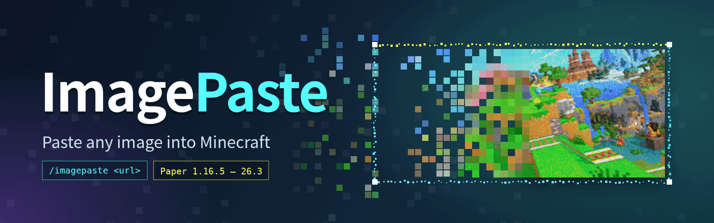
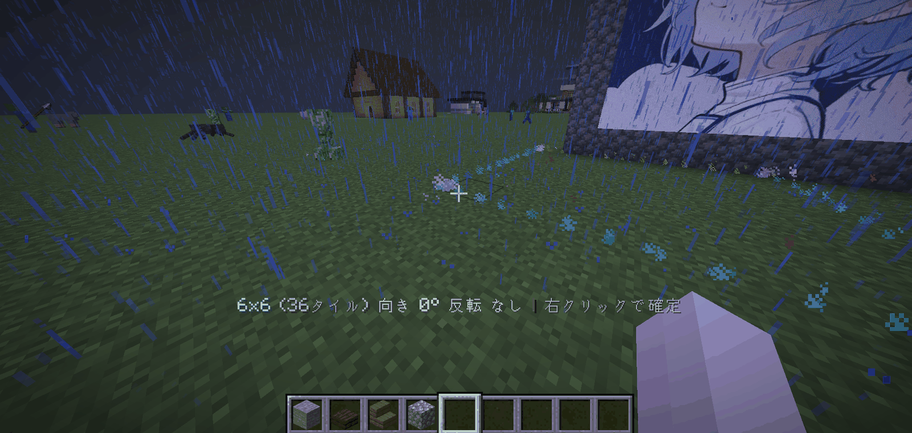
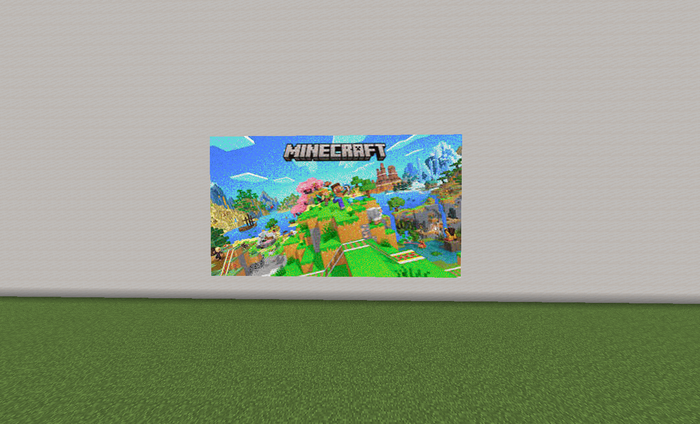

<div align="center">

<p align="center"></p>

<p align="center"><b>English</b> | <a href="README.ja.md">日本語</a></p>

<h1 align="center">ImagePaste</h1>

<h3 align="center">Paste an image from a URL onto walls, floors and ceilings as map tiles.</h3>

<p align="center">A Paper plugin for Minecraft. It shows a particle outline before placing, so you can adjust size, rotation and flip on the spot.</p>

<p align="center">
  <a href="https://github.com/Lapius7/imagepaste-plugin/releases/latest"></a>
  
  
  
  <a href="https://github.com/Lapius7/imagepaste-plugin/stargazers"></a>
  <a href="https://github.com/Lapius7/imagepaste-plugin/commits/main"></a>
</p>

<p align="center">
  <a href="#quick-start">Quick start</a> ·
  <a href="#commands">Commands</a> ·
  <a href="#configuration">Configuration</a> ·
  <a href="#safety">Safety</a> ·
  <a href="#supported-versions">Versions</a>
</p>

</div>

---

Run `/imagepaste <URL>`, look at a surface, and right-click. The image is reduced to map colors and placed as invisible item frames holding maps.

<table>
  <tr>
    <td width="50%" align="center"><br><b>Preview</b><br>A particle outline, with controls in the boss bar and chat. Cyan is the edge, white the corners, and yellow marks the <b>top</b> of the image. If any frame cannot be placed, the whole outline turns red.</td>
    <td width="50%" align="center"><br><b>Pasted result</b><br>After you right-click, the image appears on the wall as map tiles.</td>
  </tr>
</table>

## Features

- **Preview before placing**: the outline follows the surface you look at, up to `preview.max-distance` (default 64 blocks).
- **Adjust live**: Shift+scroll to resize, `F` to rotate, `Q` to flip. Right-click confirms, left-click cancels.
- **Any surface**: walls, floors and ceilings.
- **Large images**: placed over several ticks, with progress on a boss bar. `/imagepaste cancel` stops and cleans up.
- **Management**: `list`, `undo`, `remove` and `tp`. Records survive restarts.
- **Protection**: placed frames reject breaking, rotating and taking the map out.
- **Fetch limits**: internal addresses are refused, with limits on size, time and ports, and an optional host allowlist.
- **Messages** are in `lang.yml` (MiniMessage).

## Quick start

You need a Paper server (1.16.5 to 26.3) running the Java version that Minecraft release requires.

1. Download `ImagePaste-<version>.jar` from [Releases](https://github.com/Lapius7/imagepaste-plugin/releases/latest).
2. Put it in `plugins/` and start the server. `config.yml` and `lang.yml` are created under `plugins/ImagePaste/`.
3. Give yourself `imagepaste.use` (ops have it by default).
4. In game:

```
/imagepaste https://example.com/a.png width=6 quality=high
```

Look at the surface, adjust, and right-click.

| Input | Action |
|---|---|
| Shift + scroll | Resize |
| `F` (swap hands) | Rotate 90° clockwise |
| `Q` (drop) | Cycle flip: none → horizontal → vertical → both |
| Right-click | Confirm and place |
| Left-click | Cancel |

On a floor, the top of the image points where you face; on a ceiling, the opposite way; on a wall, up is up.

> [!TIP]
> With an empty hand, a right-click in the air never reaches the server. While previewing, ImagePaste temporarily puts a paper in your hand and restores your item afterwards (or at next login/startup if the server stopped first). Set `preview.air-click-item: false` to turn this off.

## Commands

`/imagepaste` (alias `/ip`) without arguments opens help. Help lines are clickable.

<details>
<summary>All commands</summary>

| Command | What it does |
|---|---|
| `/imagepaste <URL> [key=value ...]` | Start a preview. A URL is anything containing `://` |
| `help` | Show help |
| `size <w> [h]` | Set the preview size |
| `rotate [0\|90\|180\|270]` | Rotate (no argument: 90° steps) |
| `flip [none\|h\|v\|both]` | Flip (no argument: cycle) |
| `confirm` / `cancel` | Place / abort (also cancels a running job) |
| `undo` | Remove your last paste |
| `list [all] [page]` | List pastes. `all` is admin only |
| `remove <id>` | Remove by ID (others' pastes: admin only) |
| `tp <id>` | Teleport to a paste |
| `reload` | Reload `config.yml` and `lang.yml` (admin) |

</details>

<details>
<summary>Permissions</summary>

| Permission | What it allows | Default |
|---|---|---|
| `imagepaste.use` | Paste, undo, remove your own | op |
| `imagepaste.admin` | reload, list and remove others' | op |
| `imagepaste.break` | Break protected frames | op |
| `imagepaste.bypass` | Ignore cooldown and size limits | none |
| `imagepaste.max-tiles.<n>` | Per-player tile limit (largest held wins) | none |
| `imagepaste.max-size.<n>` | Per-player width/height limit | none |

</details>

## Configuration

The `defaults` section of `config.yml` holds the default options. Any of them can be overridden for one paste with `key=value` in the command.

<details>
<summary>Command options (defaults)</summary>

| Option | Values | Meaning |
|---|---|---|
| `width` (`w`) | integer | Width in blocks (default 4) |
| `height` (`h`) | integer / 0 | Height in blocks. 0 = from aspect ratio |
| `mode` | fit / fill / stretch | Fit inside / cover fully / stretch |
| `quality` | low / normal / high | Sets `resample` and `dither` together |
| `resample` | nearest / bilinear / bicubic | Scaling method |
| `dither` | none / floyd / ordered | Dithering |
| `brightness` | -1.0 to 1.0 | Brightness |
| `contrast` | 0.0 to 3.0 | Contrast |
| `saturation` | 0.0 to 3.0 | Saturation |
| `background` | transparent / #RRGGBB | Color for margins and transparent areas |
| `rotate` | 0 / 90 / 180 / 270 | Clockwise rotation |
| `flip` | none / h / v / both | Flip |
| `invisible` (config: `invisible-frame`) | true / false | Make frames invisible |
| `glow` (config: `glow-frame`) | true / false | Use glow item frames |
| `fixed` | true / false | Fixed frames |
| `blocked` (config: `on-blocked`) | abort / skip | If a spot is blocked: abort all / skip that frame |

</details>

<details>
<summary>limits, download, place</summary>

| Key | Default | Meaning |
|---|---|---|
| `limits.max-width` / `max-height` | 0 | Max blocks. 0 or less = unlimited |
| `limits.max-tiles` | 0 | Max tiles (maps) per paste. 0 = unlimited (internal cap 262144) |
| `limits.cooldown-seconds` | 10 | Delay between pastes |
| `limits.pending-timeout-seconds` | 120 | How long an idle preview is kept |
| `download.max-bytes` | 10485760 | File size limit (10 MiB) |
| `download.max-source-pixels` | 40000000 | Source image pixel limit. 0 or less = unlimited |
| `download.connect-timeout-seconds` / `timeout-seconds` | 5 / 15 | Connect / total time limit |
| `download.max-redirects` | 3 | Redirect limit |
| `download.max-concurrent` | 3 | Concurrent downloads |
| `download.allowed-ports` | [80, 443] | Allowed ports |
| `download.allowed-hosts` | [] | Empty = any public host. Otherwise exact match or subdomain only |
| `place.tiles-per-tick` | 16 | Tiles created per tick. 0 = all at once |
| `place.load-chunks` | true | If false, place only within loaded chunks |

</details>

<details>
<summary>preview, effects, protection</summary>

| Key | Default | Meaning |
|---|---|---|
| `preview.interval-ticks` | 4 | Outline refresh interval. Lower is smoother but costs more |
| `preview.max-distance` | 64 | How far to look for a surface (blocks) |
| `preview.air-click-item` | true | Give a paper for air clicks when the hand is empty |
| `preview.particle` | DUST | Particle type. Colors only apply to DUST |
| `preview.particle-size` / `edge-step` | 1.0 / 0.5 | DUST size / spacing in blocks |
| `preview.edge-color` / `top-color` / `corner-color` / `error-color` | #55FFFF / #FFFF55 / #FFFFFF / #FF5555 | Edge / top / corners / error |
| `preview.scroll-sensitivity` / `scroll-step` | 1 / 1 | Notches per step / blocks per step |
| `preview.invert-scroll` | false | Reverse scroll direction |
| `preview.actionbar-enabled` | true | Show current values on the action bar |
| `preview.guide.mode` | bossbar | Controls hint: bossbar / scoreboard / chat / none |
| `effects.place.*` | | Placement effect: `enabled`, `duration-ticks`, `count-multiplier`, `layers`, `corner-bursts`, `sounds` |
| `effects.progress.*` | | Progress display: bossbar / actionbar / title / none, `show-eta`, `frame.*` |
| `effects.remove.*` | | Removal effect: one particle and one sound |
| `protection.enabled` | true | Reject breaking, rotating, item changes and map removal |
| `protection.allow-break-permission` | true | Only holders of `imagepaste.break` can break frames |
| `protection.on-break` | protect | When a frame is lost: `protect` drops the record only, `remove-all` removes the whole paste, `regenerate` rebuilds it |

Particle names accept both new (`DUST`, `EXPLOSION_EMITTER`) and old (`REDSTONE`, `EXPLOSION_HUGE`) forms. Particles that do not exist in the running version are ignored.

</details>

`config.yml` is versioned by `config-version`. On upgrade, values still at the old default move to the new default and edited values stay. The previous file is saved as `config.yml.bak-v<old version>`.

## Safety

> [!WARNING]
> There is no tile limit by default. On a public server, set `limits.max-tiles` or `imagepaste.max-tiles.<n>`. Each map writes a `map_N.dat` file, so thousands of tiles also grow the world size.

> [!NOTE]
> Fetching accepts `http` / `https` only. Loopback and private addresses are refused, including redirect targets.

## Supported versions

One jar covers Paper 1.16.5 to 26.3. It is compiled to Java 8 bytecode against the Paper 1.16.5 API, and newer APIs are looked up at runtime. The server needs the Java version its Minecraft release requires (8+ for 1.16.5, 17+ for 1.18 to 1.20.4, 21+ from 1.20.5, 25 for 26.x).

On 1.16.5 there is no glow item frame, so normal item frames are used. 1.12.2 is not supported: it has no Adventure, no persistent data container, and a different map and material API, so it would need a separate rewrite.

**Spigot and CraftBukkit are not supported.** Messages use Adventure (MiniMessage) bundled with Paper.

<details>
<summary>Verification per version</summary>

| Version | Loads and starts | Paste to undo |
|---|---|---|
| 1.16.5 (Java 8) | Verified | Verified |
| 1.16.5 (Java 11) | Verified | Verified |
| 1.18.2 | Verified | Verified |
| 1.19.4 | Verified | Verified |
| 1.20.1 | Verified | Verified |
| 1.20.4 | Verified | Verified |
| 1.20.6 | Verified | Verified |
| 1.21.1 | Verified | Verified |
| 1.21.4 | Verified | Verified |
| 1.21.11 | Verified | Verified |
| 26.1.2 | Verified | Not verified |
| 26.2 | Verified | Not verified |
| 26.3 | Verified | Verified (by the author on a real client) |
| 1.17.x | Not tested (should work as the same jar) | - |
| 1.12.2 and older | Not supported | - |

- **Loads and starts**: the jar was put on that version's Paper server, and the log showed `Enabling ImagePaste` and finished loading with no errors.
- **Paste to undo**: a headless bot (mineflayer) joined, ran `/imagepaste <URL> width=2`, looked at a wall and right-clicked, and 4 item frames appeared. `list` showed it, and `undo` brought the count back to 0. The bot does not support 26.x yet, so on 26.3 the author checked it by hand on a real client; 26.1.2 and 26.2 were not run.

</details>

> [!NOTE]
> Not verified: the client-side controls (scroll, `F`, `Q`, right-click) and their look on a real client, and Folia. 1.12.2 and older are not supported.

## License

[MIT](LICENSE)
